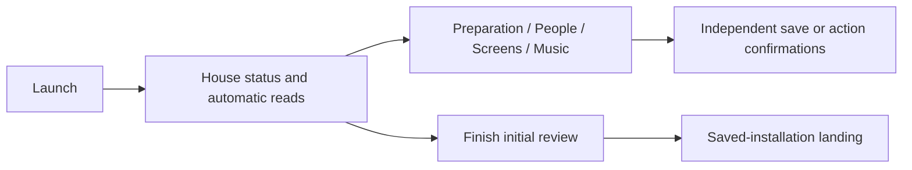
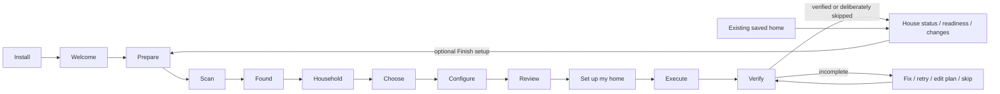

# First-run commissioning and returning-home audit

Baseline: 0.4.2 (`4d88d05`), reproduced against disposable fixtures from a fresh
runtime directory. The 0.4.3 readiness work added decisions but retained the same
independent-editor launch. Private screenshots are under `screens/commissioning-ui`.

## Actual before-state

The first viewport was House status: empty saved counts, Music app state, climate
availability and a Finish initial review button. Review setup was expanded below
status and changes, containing Fresh Batteries and optional outcomes. Inventory
and system reads began on launch, before the preparation action. Technical health
was disclosed, but the overall landing still used the maintenance structure.

`app.js:init` called installation, inventory and screen initialization, then scan.
`installation.js` opened Review setup only for first-run. Names/audience and screens
were saved by the household editor; Music installation and room assignment had
separate confirmations; dashboard preview/publication had its own confirmation.
Initial review could mark an empty household configured. There was no consolidated
plan or single Go action, and saved settings were not commissioning verification.
Read checks could save a local comparison baseline; opening a capability did not
itself install an integration. These distinctions come from UI execution and the
actual routes, not inferred product intentions.

## New flow

Fresh launch reads the local commissioning state and authenticates the administrator;
it does not initialize the maintenance scans or editors. Prepare reuses Fresh
Batteries, followed by Scan my home. Human source counts lead; room/device details
are secondary. Counts are explicitly HA sources, not guaranteed physical devices.
Unassigned devices may be ignored/hidden or resolved in HA; minor cleanup can wait.

Household records preferred names, confirmed adult/child context, rooms, personal
devices, access intent and explicit presence links. Existing sources are suggestions,
not imported identities. Choose is multi-select with evidence-based recommendations
and no new preselection. Only selected capabilities get detailed configuration.
Existing published screens are never selected for update automatically.

## Persistent states

| State | Meaning |
|---|---|
| `not_started` | No commissioning decision; distinct from historical saved configuration |
| `preparing` | Welcome accepted; prepare and explicitly scan |
| `scanned` | Complete discovery summary recorded; household can be defined |
| `household_defined` | Valid membership/context saved in the draft |
| `capabilities_selected` | Optional capability selection saved |
| `configuration_incomplete` | Configuration choices staged; no completeness claim |
| `reviewed` | Exact draft, source identities/availability and generated views bound to an expiring review token |
| `executing` | Explicit Go accepted; independent results journaled |
| `verification_incomplete` | Failed, unsupported, interrupted or unconfirmed results remain |
| `commissioned` | Supported results verified and every remaining optional result deliberately skipped |

Historical homes without this sidecar enter maintenance, not forced onboarding or
assumed commissioning. They retain people, screens, choices, history and publication
ownership, with an optional Finish setup entry. Leaving a legacy draft applies
nothing. Returning to it refreshes the draft from saved configuration. Completed
commissioning opens maintenance on subsequent visits; unfinished execution resumes
its result page. A restart never blindly replays an interrupted operation.

## Writes and the Go boundary

In the normal first-run flow before Go, only the private `commissioning.json`
draft/review is written. Scan and
review read discovery and actual upcoming calendar events. They do not save the
household, install apps, assign rooms, publish dashboards or create activity rules.
Direct mutation routes are blocked during first-run/active commissioning. Existing
configured activity monitoring continues independently; it is not a new plan action.

Review lists automatic changes, sign-in/approval tasks and manual-only work, with
generated view contents available before publication. Go can save household and
readiness decisions, run the existing Music Assistant installer if explicitly
requested, and publish only selected reviewed screens. Calendar/waste verification
is read-only and is repeated during execution. Presence verifies available source
mapping; it creates no automation. Other selected capabilities remain incomplete.

Review tokens expire after ten minutes; stale drafts, inventory identity/availability
changes and concurrent settings changes require review again. Publication retains
the original ownership, external-edit and matching-config no-op protections.
Results are saved independently. Successful publications are not replayed by Retry;
partial local saves can resume. Changed sources require editing and reviewing again.
Explicit reset backs up the commissioning sidecar alongside existing recovery data;
reset is blocked while execution is running.

Opening linked Home Assistant/service setup is a manual handoff: changes and sign-in
there are under the user's control and outside this app's automatic Go actions.
Credentials never belong in the draft. No account, permission, extension or physical
control is silently created by answering a question.

## Configuration and verification coverage

| Capability | Selection/configuration | Verification and remaining boundary |
|---|---|---|
| Household | Names, adult/child, rooms/devices, access intent and confirmed HA presence source | Local settings saved; no HA account/access creation |
| Music | Recognize existing MA app/connection; provider/account/group questions; optional installer after Go; direct MA handoff when available | Installed MA is never playback verification. Connected provider discovery, provider configuration, exact groups and actual playback remain unsupported here |
| Displays | Physical name, person/shared role, room and profile; explicit create/update selection | Exact publication readback, then explicit user confirmation that the screen opened correctly; this is labeled user confirmation, not automated visual/device verification |
| Calendars | One chosen source and displays; source setup handoff | Real upcoming event read at review and execution |
| Bins | Never preselected; explicit source/setup handoff | Real dated collection event/service required; no invented schedule |
| Presence | Confirm member/source links and purpose | All selected sources must be currently available and linked; no presence automation |
| Calling | Service, internal/external/gate intent; independent per-person destinations | Secure credentials/endpoints and enforced permissions stay in the calling service; registration/test call remain incomplete |
| Climate/lighting | Discovered sources, relevant displays and room context | Actual physical control/readback test adapter remains incomplete |
| Cameras/doorbells | Existing sources and capability questions | Live/event/recording/intercom checks remain incomplete |
| Appliances | Existing native/explicit activity sources and display relevance | No invented chores or derived completion semantics |
| Voice | Keep/remove/replace and allowed-control intentions | Actual voice/control tests remain incomplete |
| Energy/irrigation | Explicitly labeled no supported commissioning adapter | No automatic configuration or working claim |

Completion lists verified results separately from explicit skips. Unsupported tasks
do not become verified through a checkbox or app installation. Optional omissions
do not prevent a minimal household from completing commissioning.

## Acceptance evidence

API and browser scenarios cover a new simple household, an existing complex saved
home, MA without provider/playback proof, no waste source, selected communications,
and a minimal household skipping optional capabilities. Browser fixtures share a
synthetic inventory; API scenarios separately exercise MA absent/present and a
five-person, three-screen preserved household. No synthetic attestation proves
physical operation.

The scenarios assert preparation, explicit scan, household-before-personalization,
recommendations without preselection, conditional questions, review before writes,
Go, truthful results, deliberate skips, repeated reloads and maintenance transition.
Additional tests cover unauthorized mutations, stale review tokens, interrupted
execution/local writes, source proof boundaries and legacy preservation. Existing
regressions cover Pin/Hide/Reorder, inventory differences, migrations, reset,
publication recognition/no-op and privacy protections.

Reproduce browser commissioning with `devtools/v3_harness.py --fixtures --music-ready
--data-dir .runtime/commissioning-acceptance` and `devtools/e2e_commissioning.py`.
Use a fresh directory; deliberate typed resets are confined to fixed loopback
fixtures. Existing maintenance browser flows use the default fixtures without
`--music-ready`. Private captures include welcome/preparation/choice/review/result
at desktop/mobile sizes, plus the reproduced 0.4.2 landing. Real-home acceptance
must preserve installed dashboards and avoid resetting a household to test onboarding.
