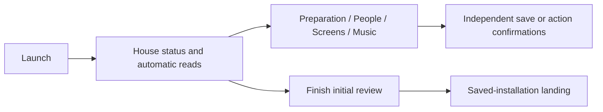
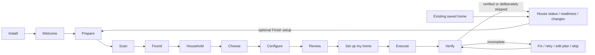

# First-run commissioning and returning-home audit

Current connection work is exposed at `/api/connections` and the same connection
view in first-run setup and Service setup. Preparation reconciles configured MA
household users and uniquely named existing Spotify providers. Renae's absent
provider is pending; no child Spotify providers are created. Existing users and
providers are retained. Returning from native sign-in triggers another check.
The Connect action records the intended identity and existing instances. Exactly
one newly authenticated instance is mapped automatically, even with its default
name; multiple newcomers require review. No provider is renamed or deleted.

Calendar classification is stored separately in private `calendar-access.json`.
New discovery starts at Needs review. Show at home, Use for context and Ignore
do not alter HA entity enablement or Google authorization. Previously explicitly
selected household calendars migrate once to Show; other calendars require a
confirmed choice. Admin previews return up to five upcoming events and source
metadata without persisting events, descriptions or attendees. Duplicate feeds
automatically show previews before saving suggestions. Confirmed classifications
also wire source verification and existing screens without a second selection.

Reclassification updates native calendar cards on owned dashboards only when
their saved fingerprint still matches. Climate, room controls and custom touch
shell templates are preserved; custom shared/personal pages use live filtered
context. Externally edited dashboards are reported for review rather than
overwritten. Successful calendar reads and confirmed playback can resume an
unfinished commissioning result automatically; installers are not replayed.

Verification: `pytest`, `node --test tests/js/*.test.mjs`,
`python devtools/e2e_connections.py` and the privacy/lint checks. Live checks on
17–18 October 2026 reconciled six MA household users idempotently (existing guest
preserved), found three connected Spotify providers with Renae absent, and read
21 calendar entities: 18 Google and three other sources. All five duplicate-label
Google feeds returned previews. The user confirmed 7 Show, 10 Context and 4 Ignore
choices. Repeated saves retained their revision; shared tablet, climate panel and
wall projections read exactly the seven Show feeds. Native shared views contained
no denied calendar references. No Google login or event export was performed.

MA 2.10.6/2.10.7 normally widens stream selection to sibling Spotify accounts. The pinned
MA-side guard closes that fallback, rejects mismatched playback credentials,
checks native queue/session occupancy and observes Grant's external playback.
Unknown external activity denies Grant overflow. Personal Grant requests release
only owned overflow; stale starts heal without stopping replacement sessions.
Soloist pairing must match the library account and retain explicit consent. Grant
overflow currently requires librespot: Soloist's own Connect device cannot yet be
distinguished safely from external personal playback without trusting its name.
The reviewed adapter records the native lease owning each Soloist run. MA schedules
stopped-buffer teardown asynchronously; a replacement can otherwise encounter an
occupied Soloist slot after the old native session ended. Only a recorded run from
an ended/replaced session may be settled, and only by a current reservation for the
same account. Active/paused, same-session and unrecognised runs are preserved.

Administrator deployment: `devtools/install_ma_guard.py --target <installed MA
mass.py> --source <reviewed guard module directory>` checks the exact upstream
source digest, retains the original source and installs a startup hook. Restart MA
to activate it. The existing /data and providers are untouched. The hook survives
process/container restarts but an upstream image replacement requires a reviewed
reinstallation; Home Starter then reports protection incomplete and refuses scoped
Spotify playback. This is not an upstream MA extension API or a published image.

Live House and personal Grant playback passed. House #2 is a distinct Premium
account with matching library/playback identities. Its former librespot audio-key
error 0 1 was resolved after the user completed Soloist consent and pairing.
MA documents Soloist as the recovery for affected accounts:
https://www.music-assistant.io/music-providers/spotify/#known-issues--notes
Its terms, API key and app pairing are a human consent/authentication boundary.
Keep the account connected; do not repeatedly re-authenticate or mask its failure
using Grant. Full live allocator checks subsequently passed on 18 October 2026.

## Household media implementation and recovery

The existing `ListeningRuntime` remains the authenticated entry point for every
screen, person page and room destination. `/api/listening/{surface}` actions now
include `surprise_me`, `something_different`, `keep_it_going`, `play_radio`,
`play_ambient` and `play_playlist`, alongside the existing saved-item controls.
The caller's HA identity, surface permissions and listener scope are checked
before selecting a destination. Dashboards contain no independent allocation or
discovery logic. `/api/media` exposes administrator preparation, station selection,
diagnostics and optional local-library cleanup.

| Component | Responsibility |
|---|---|
| `spotify_leases.py`, `ma_account_guard.py` | Single MA-side allocator, durable reservations, identity enforcement and native session ownership |
| `media_discovery.py` | Catalogue-only random seed strategies, constraints and two-hour/60-entry repeat exclusion |
| `ma_media.py` | Allocator handoff, pinned-provider similar tracks, queue policy, reseeding and fixed diagnostics |
| `media_hygiene.py` | Verified sync defaults and explicitly requested MA-only mapping cleanup |
| `listnr.py` | Public GraphQL catalogue, stable ID resolution, bounded HLS/AAC validation and fixed error categories |
| `media_catalogue.py`, `ambient_catalogue.py` | Declarative selections, availability, native free ambient sources and reconciliation |
| `ma_radio.py` | Ordinary built-in Radio items, stable MA library IDs and provenance-based recovery |
| `postal_region.py` | Local postcode calculation from country-wide public centroid data; no home coordinates sent upstream |
| `media_surfaces.py` | Media-script refresh only on fingerprint-matching owned touch dashboards |

Spotify tracks/albums/artists mirroring, album-track import, playlist-track import
and write-back are disabled; playlist sync remains enabled. The adapter disables
and reads back write-back before other changes or cleanup. Cleanup is an explicit
administrator action after a count preview: only imported Spotify mappings are
removed through MA's local controller. Other mappings and Spotify saved music are
preserved. Never reset the MA database to perform hygiene.

The global autoplay policy is `similar`, not `auto`. Spotify continuation is also
scoped to the allocated instance at the MA queue boundary. Provider failure yields
no tracks; there is no library or sibling-provider fallback. Built-in Infinite Mix
playlists are filtered from Home Starter browse, search, favourites and recents.

Surprise Me selects a year, decade/token, genre or broad-token catalogue query,
randomly chooses a playable provider result, then enables similar continuation.
Anything, Familiar-ish with configured genres, Era and Genre are API modes. This
is varied catalogue discovery, not a statistically uniform sample of all Spotify
tracks. Its allocator reservation exists before search and is transferred onto
the native queue atomically. Changed destinations/sessions discard search results.
Recent tracks, albums and artists are excluded. Default reseeding is eight tracks
or 35 playing minutes (configurable 3–30 tracks/10–120 minutes), at a track boundary.
Rapid skips do not count as completed tracks; Something different reseeds explicitly.
Automatic reseed failure disables continuation instead of switching to the library.
Discovery history and session diagnostics are ephemeral, not a listening database.

LiSTNR selections use `listnr:<opaque catalogue ID>`; the slug is a hint, not the
identity. Some IDs are alphanumeric rather than UUIDs. Playback uses the current
API-provided HLS master, including its distribution parameter. The public client
identifies itself as `Home-Starter-Public-Radio/1.0`; the generic aiohttp identifier
was rejected by the stream host during live validation. No cookies or login are
used. Child-session/segment URLs are never persisted. Unknown expiry remains null;
delivery sessions and protected streams are not imported. Selected sources are
revalidated, and unavailable/missing stations are retained with recovery states.

On a changed master URL, the importer adds the replacement mapping to the existing
library ID before retiring its old built-in URL mapping. Favourite state is kept.
Recovery can find the exact provenance marker after losing its private index;
managed stations are never matched solely by display name. MA's existing local
Ambient Sounds and Rainy Mood sources join the same Ambient category without
using Spotify; finite native effects repeat within their owned listening queue.
Earth.fm/myNoise are extension points, not scraped or silently configured sources.

LiSTNR currently returns null station coordinates. Its postcode-based web-player
lookup therefore requires explicit permission before sending an approximate
postcode to LiSTNR. The address and precise coordinates stay local. Public
[GeoNames postal data](https://download.geonames.org/export/zip/) is downloaded by
country and matched locally; attribution is shown in setup. Without permission,
unproven regional name matches do not become automatic local defaults. Manual
station choices remain available. Revoking permission preserves selected stations.

Private `media-catalogue.json` stores selections, consent, stable identities and
successful import evidence; MA's `home-starter-radio.json` stores its stable-ID
index. Include app data in HA backups. MA rebuild/provider recreation requires a
current MA connection and the reviewed account/media adapter; reconciliation then
restores selections, imports and sync policy. Image replacement still removes the
container hook: use the reproducible installer after compatibility review. No root
SSH key or administrative connection is retained as an automatic repair mechanism.

Live checks on 18 October 2026: MA 2.10.7; six users and three Spotify sources;
241 LiSTNR stations plus five native ambient entries; nine selected sources ready.
Triple M The Border and Rain played through Home Starter on an idle muted speaker;
Rain used `rain_mood` with repeat-one, radio used `builtin`, and neither used Spotify.
Surprise Me, Keep It Going and explicit reseeding passed through the Home Starter
API. A validated stream-URL update retained the same MA item ID and favourite state;
repeated imports created no duplicates. Two preparation runs retained six unique
users, three connected Spotify providers and Renae pending. Calendar classification
remained 7 Show / 10 Context / 4 Ignore; all three published shared surfaces read
only the seven Show feeds and retained their touch shell. The regression suite
passed 701 Python tests and 50 JavaScript tests; desktop/mobile browser and privacy
checks passed. API regressions reject unauthenticated and stale household edits.
Temporary root SSH access and its generated local key were removed after deployment.
After user-completed Soloist consent/pairing, all three accounts report successful
audio reads. Live allocation passed House → House #2 → Grant → explicit busy;
Grant personal playback stopped only owned Grant overflow and preserved both
shared streams. A further shared request could not steal personal playback.
Native queue stops recovered stale reservations; concurrent requests acquired
distinct House and House #2 accounts. Renae remained absent/pending throughout.
All test queues were stopped and unchanged volumes restored. This verifies decoded
stream preparation and playback progress on muted speakers, not subjective audibility.
House #2 also passed Surprise Me, Keep It Going and Something different through the
Home Starter API while House remained playing. One transient catalogue conflict
was observed before a successful retry. The stopped-session Soloist slot race was
subsequently diagnosed and covered by scoped run recovery. Unavailable catalogue
results still fail closed without library fallback. Regression coverage retains the
original listening controls when replacement fails without changing the native queue.
The deployed recovery path also passed a live deliberately unavailable-genre test:
the original House #2 track continued, retained its listening session, and stopped
successfully through Home Starter's normal control.
After explicit permission, postcode-only local discovery
passed live: 2AY, Triple M The Border 105.7 and hit 104.9 The Border ranked as nearby.
Permission survived reload; the nine saved selections and MA item IDs were unchanged.

Run the normal regression suite plus `tests/test_media_layer.py` and
`tests/test_ma_media.py`; upstream fixtures are synthetic and offline. Never treat
those tests as proof of actual Spotify entitlement, geo access or physical audio.

Baseline: 0.4.2 (`4d88d05`), reproduced against disposable fixtures from a fresh
runtime directory. The 0.4.3 readiness work added decisions but retained the same
independent-editor launch. Private screenshots are under `screens/commissioning-ui`.

## Actual before-state

The first viewport was House status: empty saved counts, Music app state, climate
availability and a Finish initial review button. Review setup was expanded below
status and changes, containing Fresh Batteries and optional outcomes. Inventory
and system reads began on launch, before the preparation action. Technical health
was disclosed, but the overall landing still used the maintenance structure.

`app.js:init` called installation, inventory and screen initialization, then scan.
`installation.js` opened Review setup only for first-run. Names/audience and screens
were saved by the household editor; Music installation and room assignment had
separate confirmations; dashboard preview/publication had its own confirmation.
Initial review could mark an empty household configured. There was no consolidated
plan or single Go action, and saved settings were not commissioning verification.
Read checks could save a local comparison baseline; opening a capability did not
itself install an integration. These distinctions come from UI execution and the
actual routes, not inferred product intentions.

## New flow

Fresh launch reads the local commissioning state and authenticates the administrator;
it does not initialize the maintenance scans or editors. Prepare reuses Fresh
Batteries, followed by Scan my home. Human source counts lead; room/device details
are secondary. Counts are explicitly HA sources, not guaranteed physical devices.
Unassigned devices may be ignored/hidden or resolved in HA; minor cleanup can wait.

Household records preferred names, confirmed adult/child context, rooms, personal
devices, access intent and explicit presence links. Existing sources are suggestions,
not imported identities. Choose is multi-select with evidence-based recommendations
and no new preselection. Only selected capabilities get detailed configuration.
Existing published screens are never selected for update automatically.

## Persistent states

| State | Meaning |
|---|---|
| `not_started` | No commissioning decision; distinct from historical saved configuration |
| `preparing` | Welcome accepted; prepare and explicitly scan |
| `scanned` | Complete discovery summary recorded; household can be defined |
| `household_defined` | Valid membership/context saved in the draft |
| `capabilities_selected` | Optional capability selection saved |
| `configuration_incomplete` | Configuration choices staged; no completeness claim |
| `reviewed` | Exact draft, source identities/availability and generated views bound to an expiring review token |
| `executing` | Explicit Go accepted; independent results journaled |
| `verification_incomplete` | Failed, unsupported, interrupted or unconfirmed results remain |
| `commissioned` | Supported results verified and every remaining optional result deliberately skipped |

Historical homes without this sidecar enter maintenance, not forced onboarding or
assumed commissioning. They retain people, screens, choices, history and publication
ownership, with an optional Finish setup entry. Leaving a legacy draft applies
nothing. Returning to it refreshes the draft from saved configuration. Completed
commissioning opens maintenance on subsequent visits; unfinished execution resumes
its result page. A restart never blindly replays an interrupted operation.

## Writes and the Go boundary

In the normal first-run flow before Go, only the private `commissioning.json`
draft/review is written. Scan and
review read discovery and actual upcoming calendar events. They do not save the
household, install apps, assign rooms, publish dashboards or create activity rules.
Direct mutation routes are blocked during first-run/active commissioning. Existing
configured activity monitoring continues independently; it is not a new plan action.

Review lists automatic changes, sign-in/approval tasks and manual-only work, with
generated view contents available before publication. Go can save household and
readiness decisions, run the existing Music Assistant installer if explicitly
requested, and publish only selected reviewed screens. Calendar/waste verification
is read-only and is repeated during execution. Presence verifies available source
mapping; it creates no automation. Other selected capabilities remain incomplete.

Review tokens expire after ten minutes; stale drafts, inventory identity/availability
changes and concurrent settings changes require review again. Publication retains
the original ownership, external-edit and matching-config no-op protections.
Results are saved independently. Successful publications are not replayed by Retry;
partial local saves can resume. Changed sources require editing and reviewing again.
Explicit reset backs up the commissioning sidecar alongside existing recovery data;
reset is blocked while execution is running.

Opening linked Home Assistant/service setup is a manual handoff: changes and sign-in
there are under the user's control and outside this app's automatic Go actions.
Credentials never belong in the draft. No account, permission, extension or physical
control is silently created by answering a question.

## Configuration and verification coverage

| Capability | Selection/configuration | Verification and remaining boundary |
|---|---|---|
| Household | Names, adult/child, rooms/devices, access intent and confirmed HA presence source | Local settings saved; no HA account/access creation |
| Music | Reconcile MA users, safe Spotify sync, isolated allocation, provider continuation, catalogue discovery and selected radio/ambient sources | Confirmed live requests and source checks are separate from installation; unresolved account playback/authentication and untested destinations remain incomplete |
| Displays | Physical name, person/shared role, room and profile; explicit create/update selection | Exact publication readback, then explicit user confirmation that the screen opened correctly; this is labeled user confirmation, not automated visual/device verification |
| Calendars | Discover sources; confirm Show/Context/Ignore classifications and displays | Native feed reads and filtered shared/personal projections; new calendars require review |
| Bins | Never preselected; explicit source/setup handoff | Real dated collection event/service required; no invented schedule |
| Presence | Confirm member/source links and purpose | All selected sources must be currently available and linked; no presence automation |
| Calling | Service, internal/external/gate intent; independent per-person destinations | Secure credentials/endpoints and enforced permissions stay in the calling service; registration/test call remain incomplete |
| Climate/lighting | Discovered sources, relevant displays and room context | Actual physical control/readback test adapter remains incomplete |
| Cameras/doorbells | Existing sources and capability questions | Live/event/recording/intercom checks remain incomplete |
| Appliances | Existing native/explicit activity sources and display relevance | No invented chores or derived completion semantics |
| Voice | Keep/remove/replace and allowed-control intentions | Actual voice/control tests remain incomplete |
| Energy/irrigation | Explicitly labeled no supported commissioning adapter | No automatic configuration or working claim |

Completion lists verified results separately from explicit skips. Unsupported tasks
do not become verified through a checkbox or app installation. Optional omissions
do not prevent a minimal household from completing commissioning.

## Acceptance evidence

API and browser scenarios cover a new simple household, an existing complex saved
home, MA without provider/playback proof, no waste source, selected communications,
and a minimal household skipping optional capabilities. Browser fixtures share a
synthetic inventory; API scenarios separately exercise MA absent/present and a
five-person, three-screen preserved household. No synthetic attestation proves
physical operation.

The scenarios assert preparation, explicit scan, household-before-personalization,
recommendations without preselection, conditional questions, review before writes,
Go, truthful results, deliberate skips, repeated reloads and maintenance transition.
Additional tests cover unauthorized mutations, stale review tokens, interrupted
execution/local writes, source proof boundaries and legacy preservation. Existing
regressions cover Pin/Hide/Reorder, inventory differences, migrations, reset,
publication recognition/no-op and privacy protections.

Reproduce browser commissioning with `devtools/v3_harness.py --fixtures --music-ready
--data-dir .runtime/commissioning-acceptance` and `devtools/e2e_commissioning.py`.
Use a fresh directory; deliberate typed resets are confined to fixed loopback
fixtures. Existing maintenance browser flows use the default fixtures without
`--music-ready`. Private captures include welcome/preparation/choice/review/result
at desktop/mobile sizes, plus the reproduced 0.4.2 landing. Real-home acceptance
must preserve installed dashboards and avoid resetting a household to test onboarding.
